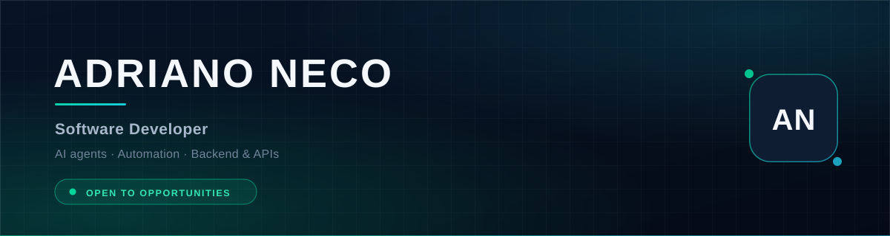
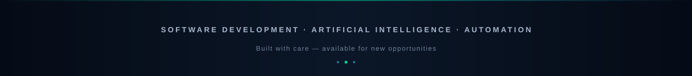

 

## About

Software developer building modern applications, **AI agents**, automations and
integrations between systems. I work across backend, APIs, infrastructure,
databases and AI tooling to ship solutions that are efficient, reliable and
built to scale.

I care about the parts that decide whether software survives production: clear
data models, honest error handling, observable services and automation that
removes work instead of moving it around.

<b>Português</b>

 

Desenvolvedor de software focado em construir aplicações modernas, **agentes de
inteligência artificial**, automações e integrações entre sistemas. Atuo em
backend, APIs, infraestrutura, bancos de dados e ferramentas de IA para criar
soluções eficientes e escaláveis.

Me importo com o que decide se um software sobrevive em produção: modelos de
dados claros, tratamento de erro honesto, serviços observáveis e automação que
elimina trabalho em vez de apenas movê-lo de lugar.

## What I build

<table>
<tr>
<td width="50%" valign="top">

**AI agents & LLM integration**

- Agent orchestration and tool calling
- Local inference with vLLM
- OpenCode workflows and skills
- Retrieval, prompts and evaluation

</td>
<td width="50%" valign="top">

**Backend & APIs**

- REST services and authentication
- Data modeling and migrations
- Queues, background jobs and webhooks
- File storage and integrations

</td>
</tr>
<tr>
<td width="50%" valign="top">

**Automation & messaging**

- Flow builders and agent bots
- WhatsApp automation (Baileys, WPPConnect)
- System-to-system integration
- Scheduled and event-driven jobs

</td>
<td width="50%" valign="top">

**Infrastructure & data**

- Linux servers, Docker, Nginx
- Cloudflare and edge configuration
- MySQL, PostgreSQL, MongoDB, Redis
- Deployment and operational tooling

</td>
</tr>
</table>

## Stack

  

## How I work

<table>
<tr>
<td width="33%" valign="top">

**Ship, then harden**

A working slice in production beats a perfect plan in a doc. I get the path
end-to-end, watch it under real load, then tighten the edges.

</td>
<td width="33%" valign="top">

**Automate the repeatable**

If a person does it twice a week, it becomes a job, a script or an agent. The
goal is less human toil, not more tooling.

</td>
<td width="33%" valign="top">

**Make it observable**

Logs, health checks and honest error messages. A failure nobody can see is a
failure you will debug twice.

</td>
</tr>
</table>

## Let's work together

**Open to full-time roles, contracts and consulting — remote, hybrid or on-site.**

  

